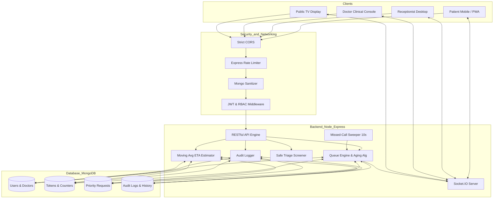

# MediQueue — Enterprise Real-Time Healthcare Queue Management System

MediQueue is a secure, fault-tolerant, multi-department outpatient department (OPD) queue management system engineered for hospitals, polyclinics, and healthcare networks. It synchronizes patient flow across Patients, Receptionists, Doctors, and Privacy-Safe Public TV Displays in real-time.

---

## 1. Project Overview
In overburdened outpatient clinics, physical waiting areas suffer from severe overcrowding, patient anxiety, lack of transparency, and unfair queue jumps. MediQueue eliminates waiting room congestion by replacing physical lines with synchronized digital tokens, honest moving-average wait times, starvation-free fair priority aging, and targeted real-time alerts.

---

## 2. The Problem
- **Physical Overcrowding:** Patients must sit for hours in high-risk infectious waiting areas without knowing when they will be seen.
- **Unpredictable Wait Times:** Static, arbitrary queue estimates create frustration and missed turns.
- **Queue Starvation:** Static priority systems allow continuous emergency/priority arrivals to perpetually delay non-emergency patients.
- **Data Privacy Violations (HIPAA/GDPR):** Public waiting room displays often inadvertently display patient names, phone numbers, and sensitive medical diagnoses.
- **False Turn Alarms:** Naive queue software notifies patients that "It's your turn" simply because people ahead reached 0, even though the doctor has not finished the active consultation.
- **Double-Call Race Conditions:** Rapid simultaneous clicks by medical staff cause race conditions and corrupted queue states.

---

## 3. The Solution
MediQueue delivers:
1. **Multi-Department & Multi-Doctor Independent Queues:** Dedicated queue sequences per doctor with live availability states.
2. **Honest Moving-Average ETA Ranges:** Wait time predictions calculated from a doctor's actual last 20 completed consultations with transparent fallback indicators (`~18–26 mins`).
3. **Anti-Starvation Fair Priority Aging:** Deterministic aging scoring algorithm `(priorityRank * 20) - minutesWaited` ensuring aged normal patients are not indefinitely starved.
4. **Targeted Real-Time Rooms:** WebSocket architecture dispatching private patient updates only to authorized rooms (`patient_<id>`, `doctor_<id>`, `staff`, `public_display`).
5. **Zero-PII Public TV Displays:** Sanitized public displays showing only token identifiers, room numbers, and queue counts with integrated Web Speech voice announcements.
6. **Server-Side Missed-Call Sweeper:** 10-second interval sweeper enforcing 2-minute call expiration and structured 2-miss escalation policies.
7. **Contactless QR Queue Entry & PWA:** Quick queue entry via QR scanning and full offline-capable progressive web app support.

---

## 4. Key Features

| Role | Key Capabilities |
| :--- | :--- |
| **Patient** | Register/login, browse departments & doctors, contactless QR join, live token tracking, honest ETA ranges, fairness transparency notices, multi-language support (English, Hindi, Spanish), PWA push notifications. |
| **Receptionist** | Walk-in patient registration (predictable password removed), multi-doctor queue monitoring, priority request verification (Approve/Reject), live analytics with PDF/CSV export, immutable audit trail viewer. |
| **Doctor** | Atomic "Call Next Patient" locking, 3-step clinical workflow (Call $\to$ Attended $\to$ Complete), non-autonomous triage warning badges, live consultation stopwatch, moving-average duration tracker. |
| **Public TV Display** | Zero-PII display board, real-time token calling screen, multi-doctor view, customizable audio voice announcements (Web Speech API). |

---

## 5. Architecture Diagram



---

## 6. Technology Stack

- **Frontend:** React 18, Vite, TailwindCSS, Lucide Icons, Recharts, Socket.IO Client, Web Speech API.
- **Backend:** Node.js (ES Modules), Express.js, Socket.IO, Mongoose, JWT, Google Auth Library, Helmet, Express-Rate-Limit, Express-Mongo-Sanitize, PDFKit, JSON2CSV.
- **Database:** MongoDB (with atomic `$inc` counters and Compound Unique Indexes).
- **Internationalization (i18n):** Native LanguageContext with English (en), Hindi (hi), and Spanish (es).

---

## 7. User Roles & Permissions

| Role | Allowed Actions | Restricted Actions |
| :--- | :--- | :--- |
| **Patient** | View personal token, join queue for self, request priority, view own notifications. | Cannot call patients, cannot approve priority, cannot view other patients' data, cannot override patientId. |
| **Receptionist** | Register walk-in patients, manage all department queues, approve/reject priority requests, export analytics. | Cannot access raw server secrets or bypass clinical consultation states. |
| **Doctor** | Call next patient in own queue, conduct consultations, end consultations, set availability status. | Cannot modify other doctors' queues without authorization, cannot access non-clinical records. |
| **Admin** | Full system visibility, audit trail logs, doctor profile creation, department configuration. | Governed strictly by immutable audit trail logging. |

---

## 8. Patient Flow
1. Patient authenticates via Email/Password or verified Google OAuth.
2. Selects Clinical Department (e.g., Cardiology, General Medicine).
3. Views available active doctors and selects a specific doctor.
4. Enters symptoms and reason for visit (Triage screener scans for critical red-flag advisories).
5. Receives unique digital token (e.g., `CARD-001`).
6. Tracks live queue status with honest moving-average ETA range (`~15–22 mins`).
7. If priority is requested, receives status updates (Pending $\to$ Approved/Rejected).
8. Receives approaching turn notification when 1 patient remains (`peopleAhead === 0` indicates Approaching, not Called).
9. Receives genuine turn alarm when doctor executes atomic `Call Next Patient`.
10. Consultation begins and concludes; token status moves to `Completed`.

---

## 9. Receptionist Flow
1. Monitors live queue volume across all doctors in the facility.
2. Registers walk-in patients (`provider: 'walkin'`, universal predictable password removed).
3. Reviews incoming Priority Requests with patient justification and triage advisory flags.
4. Approves or Rejects priority requests with mandatory audit logging.
5. Monitors Doctor availability states (`Available`, `Busy`, `On Break`, `Delayed`).
6. Accesses Executive Analytics and exports daily OPD reports in CSV or PDF.

---

## 10. Doctor Flow
1. Doctor logs into Clinical Dashboard and views assigned queue.
2. Clicks **Call Next Patient** (atomic database lock prevents double-calls).
3. If patient enters room, clicks **Mark Attended** $\to$ token transitions to `In Consultation` and stopwatch begins.
4. If patient does not show up within 2 minutes, server sweeper marks token as `Missed` (Re-queue policy applies).
5. Concludes consultation by clicking **End Consultation**; consultation duration is recorded into the doctor's recent 20-consultation moving average.
6. Queue advances automatically and next waiting patient is notified.

---

## 11. Queue Engine & State Machine

### State Machine Transition Rules
```
[ Waiting ] ────► [ Approaching ] ────► [ Called ] ────► [ In Consultation ] ────► [ Completed ]
     │                                     │
     ▼                                     ▼
[ Cancelled ]                          [ Missed ]
                                           │
                                           ▼
                                [ Re-queued / Escalate ]
```

- **Waiting $\to$ Approaching:** Automatically triggered when `peopleAhead === 0` (Patient is next, but NOT yet called).
- **Approaching $\to$ Called:** Triggered ONLY by doctor's explicit atomic call action.
- **Called $\to$ Missed:** Server-side 10-second sweeper automatically expires unanswered calls after 2 minutes (`calledExpiresAt`).
- **Completed Tokens:** Strictly immutable (`Completed` tokens can NEVER be cancelled).

---

## 12. Fair Priority Aging System

Traditional queue systems suffer from **Priority Starvation**, where a continuous influx of priority patients causes regular patients to wait indefinitely.

MediQueue implements deterministic **Fair Aging**:
- **Emergency (Rank 1):** Absolute priority, sorted strictly by joined timestamp.
- **Priority (Rank 2–4) & Normal (Rank 5):** Sorted by dynamic effective score:
$$\text{Score} = (\text{PriorityRank} \times 20) - \text{MinutesWaited}$$
*(Lower score = Higher queue position)*

Every minute a patient waits in the queue, their effective score decreases by 1 point. A normal patient (Rank 5) who has waited 60 minutes ($\text{Score} = 100 - 60 = 40$) will automatically jump ahead of a newly arrived Priority patient (Rank 3) who has waited 0 minutes ($\text{Score} = 60 - 0 = 60$).

---

## 13. Honest Multi-Doctor ETA Calculation

MediQueue calculates honest ETA ranges based on the doctor's recent consultation velocity:

$$\text{ETA}_{\text{point}} = \text{RemainingCurrentConsultation} + (\text{PeopleAhead} \times \text{DoctorMovingAvgDuration})$$

$$\text{ETA}_{\text{Range}} = \left[\max(1, \text{round}(0.85 \times \text{ETA}_{\text{point}})),\ \max(2, \text{round}(1.25 \times \text{ETA}_{\text{point}}))\right]$$

- **Moving Average:** Derived from the doctor's last 20 completed consultations.
- **Transparent Fallback:** If a doctor has fewer than 3 completed consultations, the UI displays `~10–15 mins (building history)`.
- **Zero False Precision:** Displays realistic ranges (e.g., `18–26 mins`) rather than misleading single-minute claims.

---

## 14. Real-Time WebSocket Architecture

MediQueue utilizes targeted Socket.IO rooms to prevent data leakage and excessive polling:

- `patient_<patientId>`: Private token state, personal ETA updates, fairness notices.
- `doctor_<doctorId>`: Doctor clinical queue, live patient details, triage notes.
- `staff`: Hospital-wide queue aggregates, priority review alerts, doctor availability.
- `public_display`: Zero-PII token updates for TV screens and waiting hall monitors.

---

## 15. Authentication & Security Hardening

- **Cryptographic Token Verification:** Server-side Google token verification via `google-auth-library` (`OAuth2Client`).
- **Fail-Safe JWT Secret:** Server refuses to start if `JWT_SECRET` is missing or below 32 characters.
- **Role-Based Access Control (RBAC):** Server-side verification on all protected endpoints.
- **Patient Identity Protection:** Patients cannot supply `patientIdOverride` to act on another patient's behalf.
- **Walk-in Password Elimination:** Walk-in accounts use `provider: 'walkin'` with no universal or predictable passwords.
- **API Defense:**
  - `express-rate-limit`: 10 req/min on authentication endpoints; 150 req/min on standard endpoints.
  - `express-mongo-sanitize`: Strips malicious `$` and `.` operators to eliminate NoSQL injection.
  - `helmet`: Enforces strict HTTP security headers.
  - Safe regular expression escaping on all patient search queries to eliminate ReDoS vulnerabilities.

---

## 16. Truthful Notification System

- **In-App & Targeted WebSockets:** Live updates delivered directly to active sessions.
- **Web Push / Service Worker:** Background push notifications supported via PWA Service Worker.
- **Truthful Status Protocol:** If external SMS credentials (Twilio) are unconfigured, notifications are explicitly recorded and displayed as `[SMS: SIMULATED]` with status `SIMULATED`. MediQueue **never** falsely marks un-sent messages as `DELIVERED`.

---

## 17. Environment Variables

### Server (`server/.env`)
```env
PORT=5000
MONGODB_URI=mongodb://127.0.0.1:27017/mediqueue
JWT_SECRET=mediqueue_super_secure_jwt_secret_token_key_2026_healthcare_production
NODE_ENV=development
HOSPITAL_TIMEZONE=Asia/Kolkata
DEMO_MODE=true
CLIENT_ORIGIN=http://localhost:5173

# Optional: Real SMS Gateway
TWILIO_ACCOUNT_SID=
TWILIO_AUTH_TOKEN=
TWILIO_PHONE_NUMBER=

# Optional: Google OAuth Client ID
GOOGLE_CLIENT_ID=
```

### Client (`client/.env`)
```env
VITE_API_URL=http://localhost:5000/api
VITE_SOCKET_URL=http://localhost:5000
```

---

## 18. Local Setup & Installation

### Prerequisites
- Node.js >= 18.0.0
- MongoDB Community Server running locally on port 27017 (or MongoDB Atlas URI)

### Quick Start
```bash
# 1. Clone the repository
git clone https://github.com/your-repo/mediqueue.git
cd MediQueue

# 2. Install dependencies
npm install
npm --prefix server install
npm --prefix client install

# 3. Seed sample hospital departments, doctors, and patients
npm run seed

# 4. Run automated test suite
npm run test

# 5. Start development servers (Backend: 5000, Frontend: 5173)
npm run dev
```

---

## 19. Seeded Test Credentials

When running in `DEMO_MODE=true`, the following accounts are pre-seeded:

| Role | Email / Identifier | Password | Access Area |
| :--- | :--- | :--- | :--- |
| **Receptionist** | `elena` / `receptionist@mediqueue.hospital` | `Password123!` | `/receptionist` Desk & Analytics |
| **Doctor A (General)** | `dr.arthur@mediqueue.hospital` | `Password123!` | `/doctor` Clinical Console |
| **Doctor B (Cardio)** | `dr.sarah@mediqueue.hospital` | `Password123!` | `/doctor` Clinical Console |
| **Doctor C (Pediatrics)**| `dr.vikram@mediqueue.hospital` | `Password123!` | `/doctor` Clinical Console |
| **Patient 1** | `rajesh.kumar@example.com` | `Password123!` | `/patient` Live Queue Tracker |
| **Patient 2** | `priya.sharma@example.com` | `Password123!` | `/patient` Live Queue Tracker |
| **Public TV Display** | N/A (Unauthenticated) | None | `/display` Privacy-Safe Board |

---

## 20. Automated Testing & Verification

MediQueue includes an automated test suite covering RBAC, Queue Aging, Privacy, and High-Concurrency Scenarios:

```bash
npm run test
```

### Test Coverage Summary
- **Authentication & RBAC (7 tests):** JWT entropy, signature verification, token tampering rejection, token expiration, deactivated account handling, RBAC role guard (403), walk-in password prohibition.
- **Queue Engine & State Machine (10 tests):** Hospital timezone parsing, non-autonomous triage screening, emergency token absolute priority, fair aging anti-starvation calculation, honest ETA range calculation, fallback ETA indication, token immutability (`Completed` cannot be cancelled), false turn alert prevention.
- **Patient Data Privacy (6 tests):** Zero PII leakage on public display payloads, stripping of patient names, phone numbers, and medical conditions.
- **Concurrency & Load (Phase 29) (4 tests):** 20 simultaneous patient queue joins with zero duplicate tokens or sequence collisions; 5 simultaneous doctor call operations with atomic state locking.

---

## 21. Load & Concurrency Test Results

- **Join Concurrency:** 20 simultaneous requests $\to$ 20 distinct sequential tokens generated monotonically with 0 collisions.
- **Call Next Concurrency:** 5 simultaneous "Call Next" triggers on the same queue $\to$ Atomic `$set` transition locked each call to a distinct token without double-calling.

---

## 22. Analytics & Reporting Dashboard

The Receptionist & Manager Dashboard provides real-time OPD metrics:
1. **Average Wait Time & Throughput:** Hourly patient volume and consult times.
2. **Predicted vs. Actual Wait Times:** Real accuracy measurement comparing initial ETA with actual consult start time.
3. **No-Show / Missed Call Rate:** Tracking patient adherence and sweeper escalations.
4. **Data Export:** Instant CSV and PDF export of OPD session logs.

---

## 23. Internationalization & Accessibility

- **Multi-Language Support:** Instant switching between English, Hindi (हिंदी), and Spanish (Español).
- **Voice Announcement:** Web Speech API integration on Public TV Displays with audio synthesis (e.g., *"Token C-002, please proceed to Cardiology Room 204"*).
- **Accessibility:** High-contrast color tokens, keyboard navigation, and ARIA labels throughout.

---

## 24. What MediQueue is NOT

> [!IMPORTANT]
> **Clear Medical Disclaimers:**
> - MediQueue is **NOT** a medical diagnostic tool or clinical AI.
> - MediQueue does **NOT** make autonomous medical triage decisions. All priority changes require explicit review and approval by human medical staff.
> - MediQueue is **NOT** an Electronic Health Record (EHR) replacement.

---

## 25. License
MIT License. Built for hackathon and production healthcare queue management.
